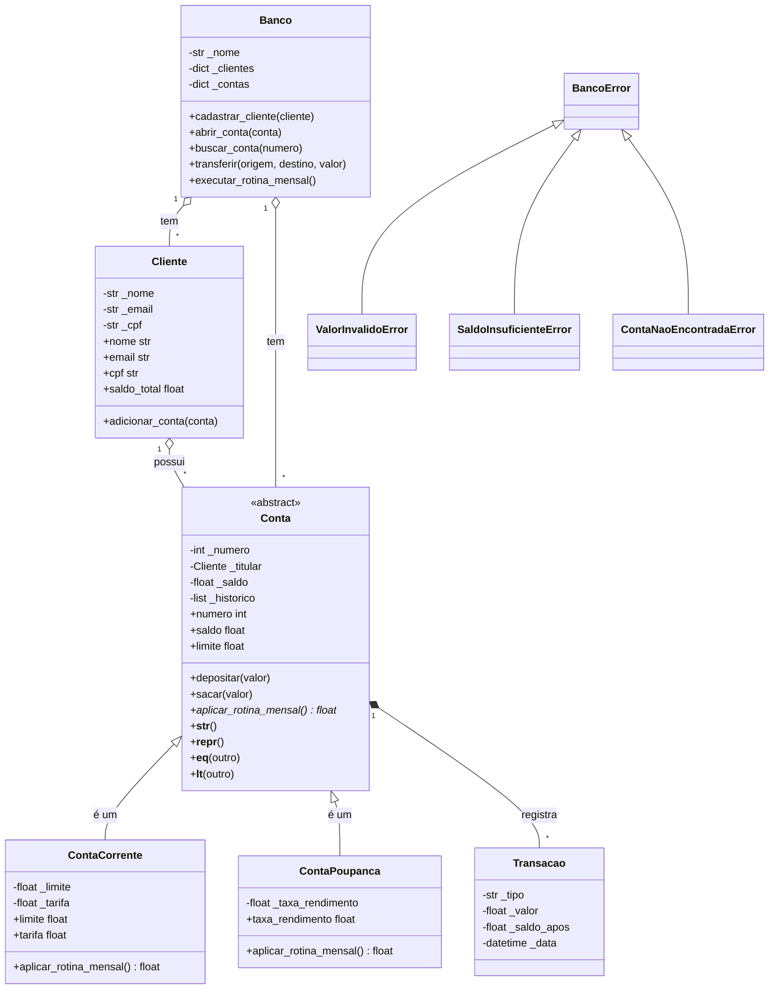

# Sistema Bancário Orientado a Objetos (Sprint 6)

Sistema em Python que modela um banco com **clientes, contas (corrente e poupança), transações e o próprio banco**, aplicando classes, encapsulamento, herança, polimorfismo e classes abstratas.

## Como executar

```bash
python main.py
```

Python 3.8+ (somente biblioteca padrão). Uma saída de exemplo está em `saida_exemplo.txt`.

## Estrutura

```
├── modelos.py         # todas as classes e exceções
├── main.py            # demonstração (12 objetos, polimorfismo, exceções)
├── saida_exemplo.txt  # saída gerada
└── README.md
```

## Diagrama de classes



## Decisões de modelagem

| Decisão | Justificativa |
|---|---|
| **Herança**: `ContaCorrente` e `ContaPoupanca` herdam de `Conta` | Relação **"é um"**: ambas são contas e compartilham número, titular, saldo, depósito, saque e histórico. Só a rotina mensal difere. |
| **Classe abstrata** `Conta` (`ABC` + `@abstractmethod`) | Não existe "conta genérica" no mundo real. O método abstrato `aplicar_rotina_mensal()` obriga cada subclasse a definir seu comportamento (contrato). |
| **Composição**: `Cliente` tem contas; `Conta` tem transações; `Banco` tem clientes e contas | Relação **"tem um"**. Um cliente *não é* uma conta, então herança seria errada aqui (princípio "prefira composição a herança"). |
| **Hierarquia de exceções** (`BancoError` → 3 filhas) | Permite capturar tudo com `except BancoError` ou tratar cada caso separadamente. |
| `Transacao` como classe própria | Dá estrutura ao histórico (tipo, valor, saldo após, data) em vez de usar dicionários soltos. |

## Encapsulamento e validações com `@property`

Atributos são privados (`_atributo`) e acessados por properties, então nenhum objeto fica em estado inválido.

| Classe | Property | Validação |
|---|---|---|
| `Cliente` | `nome` | string com ao menos 2 caracteres |
| `Cliente` | `email` | regex `^[\w.+-]+@[\w-]+(\.[\w-]+)+$` |
| `Cliente` | `cpf` | regex `^\d{3}\.\d{3}\.\d{3}-\d{2}$` |
| `Cliente` | `contas` | devolve **tupla** (cópia), protegendo a lista interna |
| `Conta` | `saldo` (setter) | rejeita saldo abaixo de `-limite` (na base, `limite = 0`, ou seja, **nunca negativo**) |
| `Conta` | `numero`, `titular` | validados no `__init__`, somente leitura |
| `ContaCorrente` | `limite`, `tarifa` | não podem ser negativos |
| `ContaPoupanca` | `taxa_rendimento` | entre 0 e 0,10 (10%) |

Truque: `Conta.limite` retorna `0.0`. `ContaCorrente` **sobrescreve** a property com o cheque especial, e o mesmo setter de `saldo` funciona para os dois tipos.

## Herança e `super()`

```python
class ContaPoupanca(Conta):
    def __init__(self, numero, titular, saldo_inicial=0.0, taxa_rendimento=0.005):
        super().__init__(numero, titular, saldo_inicial)   # reaproveita a classe mãe
        self.taxa_rendimento = taxa_rendimento             # validado pela property
```

`__str__` das filhas também usa `super().__str__()` e acrescenta informações próprias.

## Polimorfismo

```python
for conta in banco.contas:                # lista mista de Corrente e Poupança
    conta.aplicar_rotina_mensal()         # mesma chamada, comportamentos distintos
```

| Tipo | O que a rotina faz |
|---|---|
| `ContaCorrente` | cobra a tarifa mensal (retorna valor negativo) |
| `ContaPoupanca` | credita o rendimento (retorna valor positivo) |

## Métodos especiais

| Método | Uso |
|---|---|
| `__init__` | construtor com validação em todas as classes |
| `__str__` | texto amigável (todas as classes) |
| `__repr__` | texto técnico, ex.: `ContaCorrente(numero=1001, titular='Ana Souza', saldo=-315.0)` |
| `__eq__` / `__hash__` | contas comparadas pelo número; clientes pelo CPF |
| `__lt__` | contas ordenadas por saldo e clientes por nome, então `sorted()` funciona |
| `__len__` | `len(banco)` retorna o número de contas |

## Exemplos de uso

```python
from modelos import Banco, Cliente, ContaCorrente, ContaPoupanca, BancoError

banco = Banco("Sprint6")
ana = banco.cadastrar_cliente(Cliente("Ana Souza", "ana@email.com", "529.982.247-25"))

cc = banco.abrir_conta(ContaCorrente(1001, ana, 1500, limite=1000))
cp = banco.abrir_conta(ContaPoupanca(1002, ana, 5000))

cc.sacar(2300)                 # usa cheque especial: saldo = -800
banco.transferir(1002, 1001, 900)

try:
    cc.sacar(99999)
except BancoError as erro:
    print(erro)                # [SaldoInsuficienteError] Conta 1001: ...
```

## Exemplo de saída (trecho)

```
4 clientes + 7 contas + banco = 12 objetos
Banco Sprint6 | 4 cliente(s) | 7 conta(s) | R$ 22,150.00

1001 ContaCorrente   -> -R$    15.00
1002 ContaPoupanca   -> +R$    25.00
1004 ContaPoupanca   -> +R$    12.60

E-mail inválido          -> [ValorInvalidoError] E-mail inválido: 'eva@@mail'
Saque acima do limite    -> [SaldoInsuficienteError] Conta 1007: saldo R$ -4,965.00 ultrapassa o limite permitido (-R$ 100.00).
Classe abstrata          -> Can't instantiate abstract class Conta without an implementation for abstract method 'aplicar_rotina_mensal'
```

## Integrantes

- Nome 1
- Nome 2
